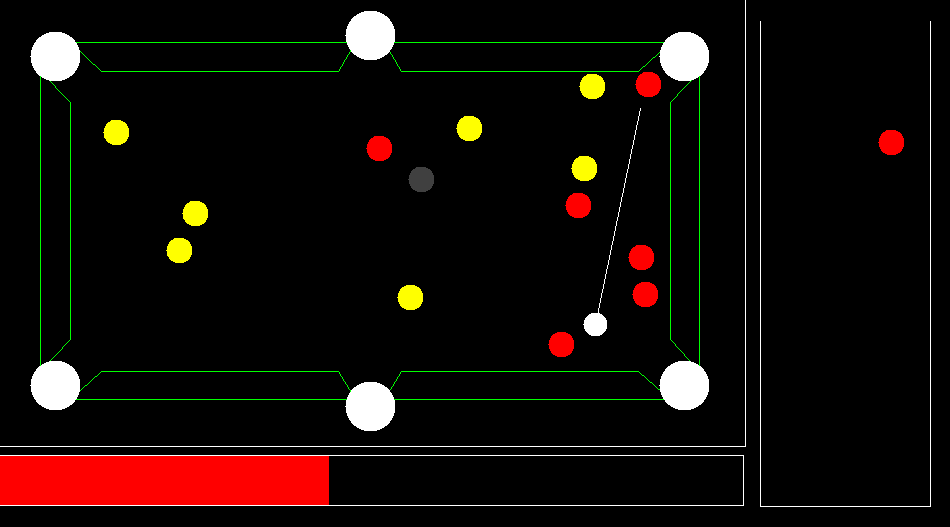

# Pool Physics Engine

### Description

After creating my own 3D game I was interested in the actual maths and physics behind some of the major functions. Taking classes in UNI had helped me make this project happen. 

First the walls are marked out and the positions are stored. Each frame the positions of the bass are checked to see if they are within collision. Applying ... the balls can bounce off the wall.

Once a ball fully colides with one of the pockets then it is considered potted and gets added to the jar. This is mostly for fun but demonstrates the same collision model with the addition of gravity and bounce.

The user can click and drag the ball to power it up indicated by the metre at the bottom. The more full the more powerful the shot is going to be. The ball then gets stepped forward based on the direction of the mouse to find what the ball would collide with given the trajectory. A line is then drawn from the ball origin to where the ball is going to collide for an accurate aiming mechanic. Makes the game more fun to play in my opinion. 

Friction is applied to the balls on the table to ensure that they all slow to a stop to allow the game to continue.

The game doesn't restart when you pot all the balls neither does it keep track of the score. 

### Usage

Ensure you have a java jdk installed on your computer and is running within cmd.

Clone this repository in your own directory and within cmd cd to the correct path. Type in the command to run the compiled JAR

java -jar "./Physics Assignment.jar"
